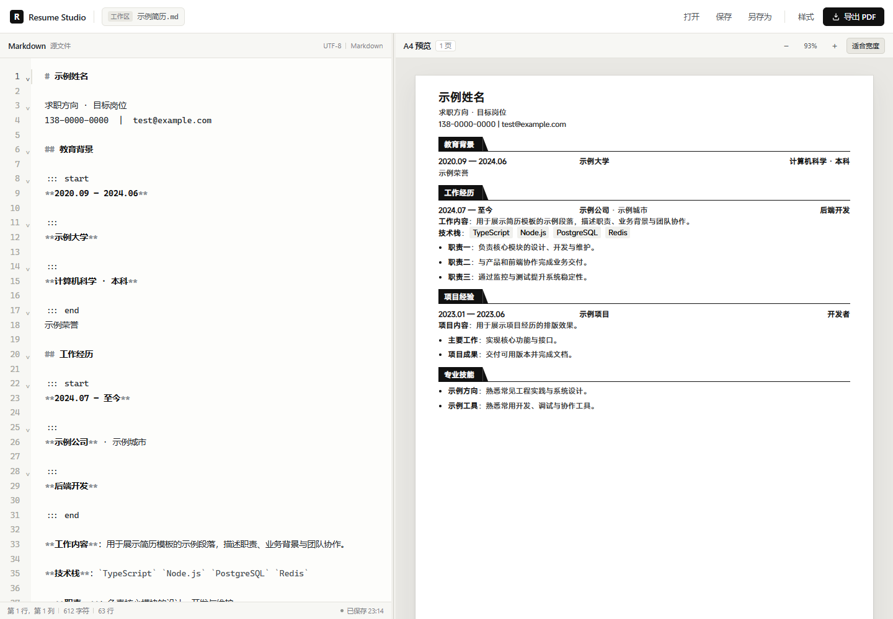
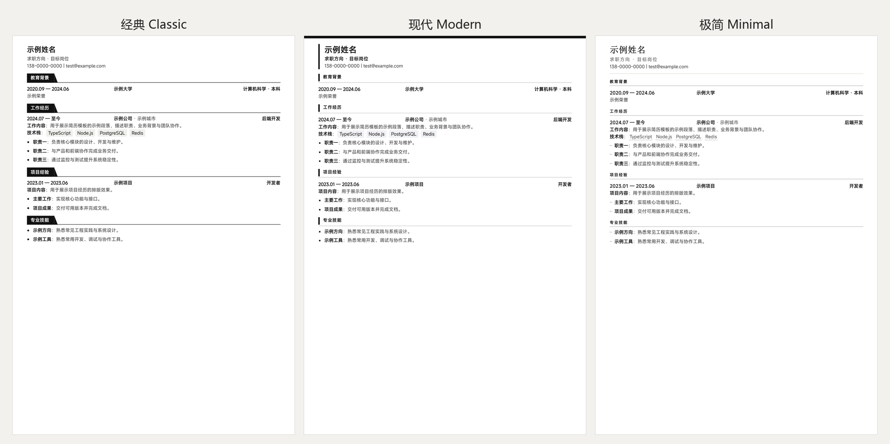

# Resume Studio

一个完全本地运行的 Markdown 简历编辑器与 A4 PDF 生成器。以工作区中的 Markdown 为唯一内容源，以现有 PDF 简历为排版参考，提供实时 A4 预览、样式调整、文件保存和一键导出可搜索的 PDF。

除当前简历外，也可以从通用空白模板新建简历；提供经典、现代、极简三套可切换模板。证件照支持本地上传、在 A4 预览中直接拖动、调整尺寸与形状，并随样式独立保存。



## 目录

- [快速开始](#快速开始)
- [已实现功能](#已实现功能)
- [使用方式](#使用方式)
- [Markdown 约定](#markdown-约定)
- [三种简历模板](#三种简历模板)
- [样式配置](#样式配置)
- [PDF 导出方案](#pdf-导出方案)
- [排版还原依据](#排版还原依据)
- [文件安全](#文件安全)
- [项目结构](#项目结构)
- [开发与测试](#开发与测试)
- [已知限制](#已知限制)
- [故障排查](#故障排查)

## 快速开始

环境要求：

- Node.js 20.19+ / 22.12+（开发时使用 Node 24）
- 本机安装 Google Chrome 或 Microsoft Edge（用于打印 PDF，不会上传任何内容）
- Windows / macOS / Linux 均可运行；字体可用性取决于系统

安装依赖：

```bash
npm install
```

开发模式（Vite + Express）：

```bash
npm run dev
```

打开 <http://localhost:5173>。API 服务运行在 `http://127.0.0.1:3001`，由 Vite 代理。

生产模式：

```bash
npm run build
npm start
```

打开 <http://127.0.0.1:3001>。Express 会同时提供 `dist/` 静态页面与本地 API。

默认启动时会扫描工作区根目录，自动打开最新的 `.md` 简历（`README.md` 会被排除），并读取同目录 PDF 作为只读样式参考。

> 公开仓库不包含个人简历、参考 PDF 或证件照。首次启动若没有 `.md`，可点击「打开 → 新建空白简历」，或把你的 Markdown 放入根目录；参考 PDF 和默认照片都是可选项。

### 环境变量

| 变量 | 默认值 | 说明 |
| --- | --- | --- |
| `PORT` | `3001` | Express 端口，仅生产模式影响页面地址 |
| `HOST` | `127.0.0.1` | 监听地址，默认只允许本机访问 |
| `CHROME_PATH` | 自动探测 | 手动指定 Chrome/Edge 可执行文件 |

示例：

```powershell
$env:PORT="3002"
npm start
```

## 已实现功能

### 编辑器

- CodeMirror 6，Markdown 语法高亮、行号、自动缩进、括号补全、搜索、撤销/重做（`Ctrl+Z` / `Ctrl+Shift+Z`）；选中文本有清晰高亮，当前光标行也不会遮住选区。
- 左右分栏，中间分隔条可拖动调整宽度，双击恢复默认比例；比例持久化。
- 自动保存本地草稿，刷新页面后恢复未保存内容；页面隐藏时同步落盘草稿。
- `Ctrl+S` 保存到当前工作区文件，`Ctrl+Shift+S` 另存为，`Ctrl+O` 打开文件。
- 编辑器底部显示行列、字符数、行数与保存状态。

### 预览

- 按固定 A4 纸张（210 mm × 297 mm）分页渲染，不是普通 Markdown 阅读页。
- 预览与 PDF 使用同一套 React 组件与 CSS 模板。
- 分页在浏览器中完成：测量块高度、避免标题/经历标题与正文分离、列表项可独立跨页。
- 缩放范围 40%–150%，默认按可用宽度适配。
- 多页时显示页数提示；单块内容超过一页时显示错误提示并暂停导出。
- 不自动缩小字体来强行凑一页。

### 样式

- 三套可切换模板：经典、现代、极简。
- 正文字号、行高、项目标题字号。
- 上/下/左/右页面边距。
- 模块间距。
- 字体族（MiSans、微软雅黑、Noto Sans SC、等线、宋体、系统无衬线）。
- 主题颜色。
- 是否显示模块分隔线。
- 照片：上传/更换 PNG、JPEG、WebP，自动压缩；在 A4 预览中直接拖动位置；调整宽高、形状（直角/圆角/圆形）；复位到右上；隐藏或恢复默认照片。
- 修改实时生效，并独立保存在 `localStorage`，不写入 Markdown。

### 文件

- 启动自动加载最新 Markdown 简历。
- 打开工作区内的其他 `.md` 文件。
- 从电脑导入 `.md` 文件。
- 新建一份通用空白简历模板，按需改写后另存为。
- 保存到原工作区文件；另存为新的 `.md` 文件。
- 保存前校验文件名、路径与扩展名；写入失败、文件已存在、权限问题等均有反馈。
- 逐行保留已有文件中未改动行的原始换行符（支持 CRLF/LF 混用）；未编辑时直接保存是字节级不变的。
- 永远不会写入参考 PDF；导出的 PDF 只通过浏览器下载，不在服务端落盘。

### PDF

- 默认文件名 `resume.pdf`，A4 页面。
- 中文字体嵌入；文字可选择、复制、搜索，不是整页图片。
- 保留超链接（`http/https/mailto/tel`）。
- 打印背景色、主题色、标签底色。
- 页面数量与预览一致；没有空白页。
- 内容多时自然分页，不强制压缩。

## 使用方式

1. 启动后确认顶部文件名是目标 Markdown，或点击「打开 → 新建空白简历」从模板开始。
2. 在左侧编辑内容，右侧立即更新 A4 预览。
3. 在「样式」面板选择经典/现代/极简模板，并调整字号、行高、边距、字体、主题色和分隔线。
4. 在「照片」区域上传图片，然后直接在右侧预览中拖动照片，或用 X/Y/宽高精确调整。
5. 点击「保存」写回工作区文件；「另存为」创建新文件；浏览器草稿会自动保存。
6. 点击「导出 PDF」，浏览器下载 `resume.pdf`。
7. 「打开」可切换工作区文件、导入电脑上的 Markdown、新建空白简历，或在新标签页查看参考 PDF。

> 从电脑导入或新建的文件只存在于当前页面状态中。要持久化，请使用「另存为」写入工作区。工作区文件的未保存草稿会在刷新后恢复。

## Markdown 约定

标准 Markdown 用于内容：一级标题作为姓名，紧随其后的段落行作为职位与联系方式，`##` 为模块，`###` 为项目标题，`-` 为要点，`**粗体**`、`` `行内代码` ``、链接和分隔线均可使用。

参考简历使用了一个三列结构，用自定义 `:::` 块表达：

```markdown
::: start
**2024.09 — 2027.06**

:::
**示例大学**  `示例标签`

:::
**计算机技术 · 硕士**

::: end
入学成绩排名 1/35
```

- `::: start` 与 `::: end` 之间是一个三列行。
- 中间的 `:::` 是列分隔符，依次对应：左侧日期、中间机构/项目名、右侧职位/学位。
- 两列时自动按「左 + 右」布局；单列时占满整行。
- 块后紧随的普通文本（例如「入学成绩排名」）作为该条目的补充说明。
- 仅包含空白或 `ㅤ` 占位符的 `:::` 块会被视为排版留白，不输出可见内容，避免产生空白页。

一行以 `` ` `` 包裹的内容在正文中渲染为浅灰技术栈标签；在三列行中渲染为 `示例标签` 这类标签。

出于安全考虑，Markdown 中的原始 HTML 不会执行或渲染，链接只允许 `http`、`https`、`mailto`、`tel` 和页内锚点；正文中的图片语法只显示替代文字。证件照通过样式面板上传和拖动，不依赖 Markdown 中的图片链接。

## 三种简历模板



三套模板共用同一份 Markdown、照片和样式配置，在「样式 → 模板」中即时切换，网页预览与 PDF 同步生效。

- **经典 Classic**：黑底白字模块标签、右侧斜切收尾、三列经历与浅灰标签，最接近原稿样式。
- **现代 Modern**：页面顶部主题色条、页眉左侧强调线、主题色模块标题、方形要点，日期使用主题色。
- **极简 Minimal**：衬线姓名与项目标题、细线模块标题、短横线要点、描边标签，留白更克制。

模板只改变版式；字号、行高、边距、字体、主题色、照片位置与尺寸仍然独立生效。切换模板不会修改 Markdown，也不会移动照片。

## 样式配置

默认值来自对参考 PDF 的测量：

| 项目 | 默认值 |
| --- | --- |
| 模板 | 经典 / 现代 / 极简（默认经典） |
| 纸张 | A4，210 mm × 297 mm |
| 上边距 | 6.1 mm |
| 下/左/右边距 | 10.6 mm |
| 正文字号 | 9.75 pt |
| 行高 | 1.54 |
| 项目标题 | 12.75 pt |
| 姓名 | 标题字号 × 1.18 ≈ 15 pt |
| 模块间距 | 9 pt |
| 字体 | MiSans（参考稿 Alibaba PuHuiTi 的近似替代） |
| 正文/粗体颜色 | `#333333` / `#111111` |
| 主题色 | `#111111` |
| 默认照片 | 若工作区存在 `public/reference/profile.png` 则使用；否则无默认照片，可上传替换 |
| 自定义照片 | 上传后压缩为最长边 900px 的 JPEG，可拖动/缩放/改形状 |

照片位置以 A4 页面左上角为原点，单位为 mm；默认 `X=175.3, Y=6.1`。可直接在预览中拖动，也可以在样式面板输入精确值，或点击「复位到右上」。

修改样式会重新分页。样式（包括自定义照片）保存在浏览器 `localStorage` 的 `resume-studio:style:v1`，草稿按文件保存在 `resume-studio:draft:v1:*`。

## PDF 导出方案

1. 前端完成分页，生成多个固定 A4 尺寸的 `.r-page` 元素。
2. 导出时只读取这些 `.r-page` 的 `outerHTML`，连同当前样式配置发送给本地 API。
3. 服务端用 `sanitize-html` 白名单清洗 HTML：默认照片替换为内联 data URI；自定义照片本身已是压缩后的 JPEG data URI，只允许 `data:image/*` 形式进入 ``。
4. 服务端注入共享的 `src/resume/resume.css`、打印 CSS 和样式变量。
5. `playwright-core` 启动本机 Chrome/Edge，设置 `@page { size: A4; margin: 0 }`，以 `printBackground: true`、`preferCSSPageSize: true` 打印。
6. 生成的 PDF 直接以二进制返回，浏览器下载为 `resume.pdf`。

因为预览和 PDF 共用同一套 DOM 结构与 CSS，只存在打印引擎的极小度量差异；PDF 仍是矢量文字，可搜索、复制和选中。

打印页面会阻止所有外部 HTTP(S) 请求，只允许内联字体/图片数据，避免把简历内容发到网络。

## 排版还原依据

对参考 PDF 的测量结果（开发时使用本地参考文件，未纳入公开仓库）：

- 页面：A4，约 595.9 × 841.9 pt。
- 左右边距 30 pt（10.6 mm），下边距 30 pt，上边距约 17.2 pt（6.1 mm）。
- 正文字号 9.74 pt，行高 15 pt；项目标题 12.74 pt；姓名 15 pt。
- 大节标题为黑底白字标签，高约 19.5 pt，右侧斜切收尾；标签下方为 0.75 pt 横线。
- 三列经历行：日期左对齐、机构/项目在约 34.25% 处开始、职位右对齐。
- 教育经历中的 `211`/`双一流` 为浅灰圆角标签；技术栈为浅灰行内标签。
- 证件照默认约 22 mm × 27 mm，位于页面右上、内容区内侧约 6 pt；位置、尺寸和形状可在样式面板/预览中调整。
- 正文 `#333333`，粗体与标题 `#111111`，强调只靠字重和少量浅灰底色。

这些规则集中在 `src/resume/resume.css` 与 `src/resume/style.ts`，便于后续微调。

## 文件安全

- 服务端只写入工作区根目录下的 `.md` 文件，拒绝路径分隔符、`..`、隐藏文件、`README.md` 和非 Markdown 扩展名。
- 参考 PDF 只读；保存接口不可能写入 PDF，也不会覆盖它。
- Markdown 读取会去除 BOM，并把行尾统一为 LF；写回已有文件时逐行恢复未改动行的原始 CRLF/LF（参考稿本身是混用行尾）。
- 写入采用临时文件 + rename，失败时清理临时文件并返回具体错误。
- 服务默认只监听 `127.0.0.1`。
- PDF HTML 经过服务端白名单清洗，原始脚本、事件属性、危险 URL 均被移除；自定义照片只允许 `data:image/png|jpeg|webp` 数据进入 ``。
- 上传的照片只保存在浏览器 `localStorage` 的样式配置里，不会写入工作区文件；导出时随页面发送给本地 PDF 服务。
- 不使用数据库、登录、云服务或任何 AI API。

## 项目结构

```text
resume-generator/
├── resume.md                     # 可选：你的本地简历（不纳入公开仓库）
├── reference.pdf                 # 可选：本地样式参考 PDF（不纳入公开仓库）
├── docs/
│   ├── ui.png
│   ├── ui-style-panel.png
│   ├── templates.png
│   ├── pdf-page1.png
│   └── generated-resume.pdf
├── public/
│   └── favicon.svg
├── scripts/
│   └── smoke-test.mjs             # Playwright 验收脚本（自建通用测试数据）
├── server/
│   ├── index.ts                   # Express 路由与静态服务
│   ├── files.ts                   # 扫描、读取、原子写入
│   ├── pdf.ts                     # 清洗 HTML、Chrome 打印 PDF
│   └── errors.ts
├── src/
│   ├── App.tsx                    # 应用状态、文件操作、快捷键
│   ├── api.ts
│   ├── storage.ts
│   ├── types.ts
│   ├── components/
│   │   ├── Toolbar.tsx
│   │   ├── MarkdownEditor.tsx
│   │   ├── PreviewPane.tsx
│   │   ├── SplitPane.tsx
│   │   ├── StylePanel.tsx
│   │   ├── Dialogs.tsx
│   │   └── ToastStack.tsx
│   ├── resume/
│   │   ├── parser.ts              # Markdown → 简历块
│   │   ├── InlineMarkdown.tsx     # 行内 Markdown（禁用原始 HTML）
│   │   ├── ResumeBlocks.tsx       # 简历组件
│   │   ├── usePagination.ts       # A4 分页
│   │   ├── photo.ts               # 图片压缩/白底 JPEG 转换
│   │   ├── template.ts            # 新建空白简历模板
│   │   ├── style.ts               # 样式类型、默认值、CSS 变量
│   │   └── resume.css             # 预览/PDF 共用纸张样式
│   └── styles/app.css             # 编辑器界面样式
├── index.html
├── vite.config.ts
├── tsconfig.json
├── package.json
└── README.md
```

`README.md` 会被扫描逻辑排除，不会被当作简历。

## 开发与测试

```bash
npm run typecheck   # TypeScript 类型检查
npm run build       # 类型检查 + Vite 生产构建
npm run dev         # 启动 API 5173/3001 开发服务
npm run start       # 启动生产服务（需先 build）
```

浏览器验收脚本（需先启动 `npm run dev`）：

```bash
node scripts/smoke-test.mjs
```

脚本会自建通用测试数据 `__smoke-source.md`，并创建 `__smoke-test.md`；结束时删除这两个文件，同时保留 `smoke-style.pdf` 供人工检查。三个文件都在 `.gitignore` 中排除。

脚本覆盖：

1. 自动加载通用测试 Markdown，验证 A4 渲染与分页。
2. 在同一页内逐字编辑，校验预览即时刷新（不依赖页数变化）；当前光标行的选区高亮可见。
3. 另存为临时文件，避免修改测试源文件。
4. 编辑内容，校验预览实时更新。
5. 保存到磁盘并刷新，校验内容一致。
6. 不保存直接刷新，校验草稿恢复。
7. 修改字号、行高、标题、边距、模块间距、主题色、分隔线与照片显示开关，校验预览和持久化。
8. 上传测试图片，校验自动压缩、缩略图、预览拖动、X/Y 更新和 localStorage 持久化。
9. 在自定义样式下实际导出 PDF。
10. 检查每页没有内部溢出。
11. 恢复默认样式后，用短内容验证单页排版。
12. 从电脑导入本地 Markdown。
13. 通过「打开 → 新建空白简历」验证通用模板与另存为入口。
14. 校验路径穿越、保留名、非 Markdown、重复文件、空页面等 API 错误。
15. 校验无页面异常、无 XSS、通用测试源文件哈希不变。
16. 依次切换经典/现代/极简模板，校验预览模板类、标题样式与分页。

实际验收结果（基于通用测试数据）：

- 通用测试简历：1 页 A4；包含教育背景、工作经历、项目经验、专业技能。
- 同页增量编辑：输入字符后预览在 1 帧内更新（实测约 3 ms），撤销后同步恢复；当前行与普通行的选区高亮均可见。
- 示例导出：[docs/generated-resume.pdf](docs/generated-resume.pdf)，1 页，约 309 KB；中文文字可提取。
- 三套模板均导出 1 页 PDF：[模板对比](docs/templates.png)。经典黑底标签、现代顶部色条/左侧强调、极简衬线姓名/细线标题均正常；无页面内部溢出。
- 自定义照片：上传 800×1000 测试照片后自动压缩为 720×900 JPEG 嵌入 PDF；拖动后 X/Y 从 175.3/6.1 变为 130.2/55，刷新后照片、位置、尺寸、圆角形状均保持。
- 自定义样式导出：1 页；4×4 测试照片以 data URI 嵌入 PDF；`mailto:` 与 `https://` 链接均生成 PDF 链接注释。
- 新建空白简历：渲染为 1 页，包含教育背景/工作经历/项目经验/专业技能模板；点击保存正确进入「另存为 Markdown」。
- 所有预览页面 `scrollHeight <= clientHeight + 1`，没有页面内部裁切。
- 保存未编辑内容时保留原有 CRLF/LF 行尾；通用测试源文件在测试前后哈希不变。
- 公开仓库不包含真实简历、参考 PDF 或证件照；测试使用自建的通用 fixture。

## 已知限制

1. **字体依赖本机**。参考稿使用 Alibaba PuHuiTi 2.55 Regular；本机未安装该字体，默认用 MiSans 近似，可在样式面板切换微软雅黑/等线/Noto Sans SC/宋体。未安装所选字体时会回退到系统无衬线字体。
2. **MiSans/Noto Sans SC 的 PDF 字体嵌入形式**。Chrome 打印 OTF/可变字体时可能以 Type3 矢量字形嵌入；文字仍可选择、复制、搜索（已用 PyMuPDF、pypdf 验证），但若更看重 PDF 字体的通用性，建议选择微软雅黑或等线，导出为标准 Type0 字体。
3. **不自动压缩到一页**。内容超出时自然分页并提示；不通过缩小字号强行塞入一页。
4. **单个块超过一页时不导出**。例如一整段超长文字本身就高于 A4 内容区，界面会提示拆分或调小字号，并暂停导出，避免生成被裁切的 PDF。
5. **从电脑导入或新建的文件不直接写回原路径**。浏览器无法静默写回任意本地路径；请使用「另存为」保存到工作区。刷新后应用会打开工作区文件，本地临时导入/新建的草稿不会自动重新出现。
6. **照片保存在浏览器本地**。若工作区存在 `public/reference/profile.png` 则作为默认照片；公开仓库不包含该文件。上传照片会压缩为最长边 900px 的 JPEG，并写入 `localStorage` 样式配置，不会写入工作区文件。清除站点数据/换浏览器后需重新上传。照片可以自由拖动，位置可能覆盖正文，请自行调整。
7. **原始 HTML 不渲染**。这是安全取舍；需要强调的内容使用 Markdown 粗体、链接或行内代码。
8. **PDF 页面尺寸**。Chrome/Skia 输出的 A4 宽度约为 595.0 pt（标准 A4 为 595.28 pt），高度 841.9 pt；在阅读器中仍按 A4 处理，不影响排版与打印。
9. **预览不自动跟随编辑位置**。内容始终实时更新，但预览滚动位置保持不变；编辑当前视口之外的页时，需要手动滚动到对应页面。
10. **调试产物**。`docs/generated-resume.pdf` 是验证时生成的实际 PDF 示例；正式投递前请重新导出。

## 故障排查

**导出时提示找不到 Chrome/Edge**

安装 Chrome 或 Edge，或指定路径：

```powershell
$env:CHROME_PATH="C:\Program Files\Google\Chrome\Application\chrome.exe"
npm run dev
```

**端口被占用**

Vite 固定使用 5173；如被占用，修改 `vite.config.ts` 的 `server.port` 或关闭占用进程。生产 API 可通过 `PORT` 改端口。

**PDF 导出失败**

查看启动服务的终端输出。首次启动 Chrome 需要 1–3 秒；如果浏览器进程崩溃，下一次导出会自动重启。确认参考 PDF 未被其他程序占用（工具本身只读它）。

**中文显示为方框**

所选字体未安装或字体回退失败。安装 MiSans/微软雅黑，或在样式面板切换到「系统无衬线」/「微软雅黑」。

**保存失败：文件已存在**

「另存为」默认不覆盖已有文件。确认后会显示「覆盖并保存」；「保存」按钮写回当前工作区文件时不需要确认。

**刷新后没有恢复草稿**

草稿按文件保存在当前浏览器的 `localStorage`。清理浏览器站点数据、使用无痕窗口或更换浏览器会丢失草稿；工作区文件本身不受影响。
# resume-studio
