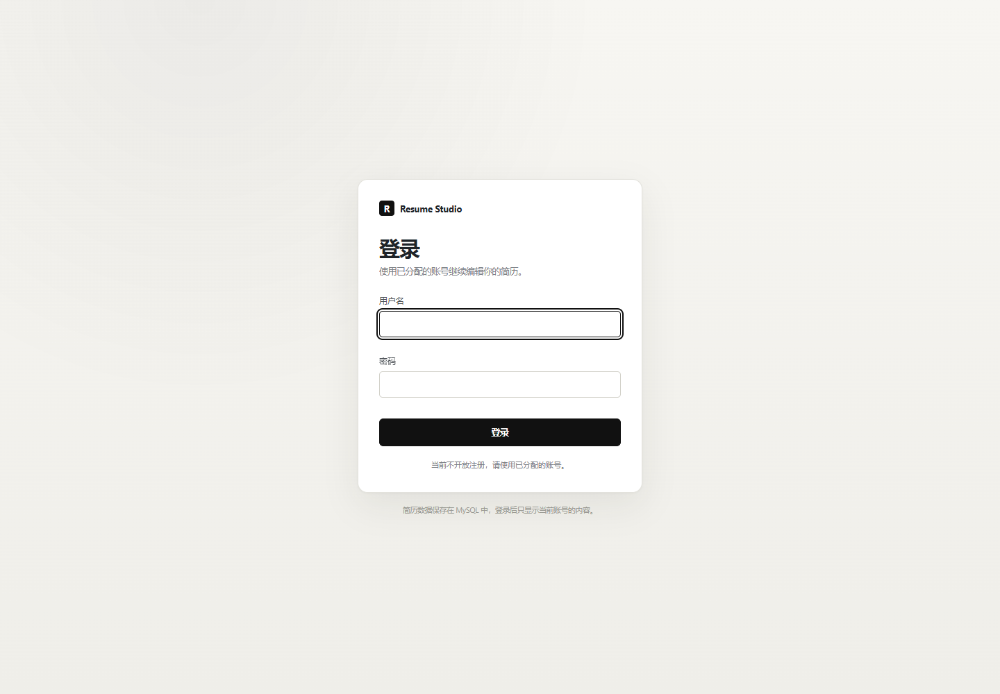
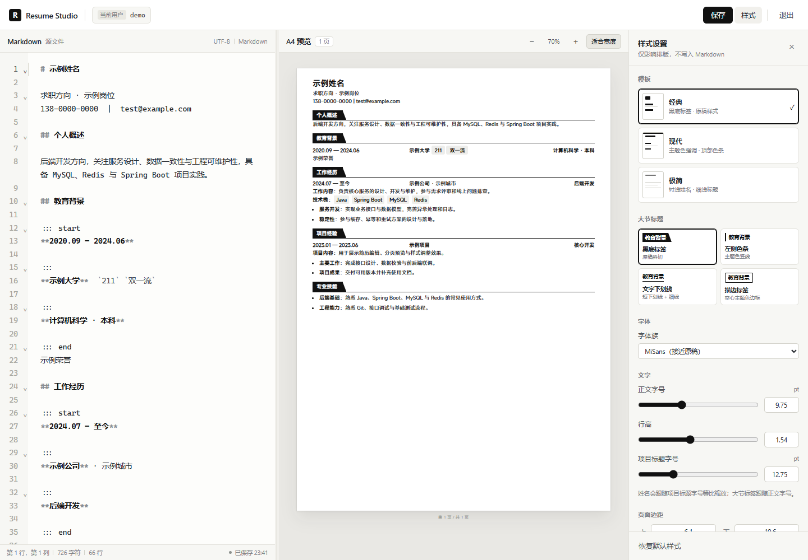

# Resume Studio

一个以 Markdown 为唯一内容源、使用 MySQL 保存账号与简历的 A4 简历编辑器。登录后只加载当前账号最后一次保存的简历；没有保存记录的新用户会得到一份可编辑的通用框架。

当前版本提供实时 A4 预览、经典/现代/极简三套模板、样式调整和证件照编辑。**不提供注册，也不提供 PDF 导出**。




## 功能

### 账号与数据

- MySQL 用户登录，**不开放注册**，账号由部署者在 `.env` 的 `SEED_USERS` 中预置。
- 每个用户一条 `resumes` 记录；保存时写入当前账号的内容，登录时只读取自己的数据。
- 新用户没有简历记录时自动保存一份通用 Markdown 框架。
- 可选把项目根目录已有的 `.md` 导入给某个种子用户，作为其初始简历。
- 密码使用 `scrypt` 加盐哈希存储；登录会话使用 HMAC 签名的 HttpOnly Cookie。
- 登录尝试按 IP + 用户名限流：10 分钟内最多 5 次。
- 退出登录会清除会话 Cookie。

### 编辑与预览

- CodeMirror 6：Markdown 语法高亮、行号、自动缩进、括号补全、搜索、撤销/重做。
- 左右分栏可拖动调整，双击恢复默认比例。
- 固定 A4 纸张（210 × 297 mm）分页，不是普通 Markdown 阅读页。
- 前端测量块高度并分页，避免标题与正文分离；列表项可跨页。
- 缩放 40%–150%，支持按可用宽度适配；内容超出单页时给出提示。
- 编辑器底部显示行列、字符数、行数与保存状态。
- `Ctrl+S` 保存到 MySQL，`Ctrl+Shift+Z` 撤销重做。

### 样式与模板

- 经典、现代、极简三套可切换模板。
- 四种大节标题样式：黑底标签、左侧色条、文字下划线、描边标签。
- 正文字号、行高、项目标题字号、页边距、模块间距。
- 字体族（MiSans、微软雅黑、Noto Sans SC、等线、宋体、系统无衬线）。
- 主题颜色、模块分隔线开关。
- 证件照上传/更换 PNG、JPEG、WebP，自动压缩；在 A4 预览中拖动位置；调整尺寸与形状；隐藏或恢复默认照片。
- 样式保存在浏览器 `localStorage`，不写入 Markdown，也不写入 MySQL。

### 安全边界

- 简历 API、照片 API 都要求登录；静态登录页公开。
- 无注册接口，未登录不能读取或保存简历。
- 数据只写入 MySQL，不再读写工作区 `.md` 文件。
- 不使用第三方登录、云服务或 AI API。

## 快速开始

### 1. 准备 MySQL

要求 MySQL 8.0+。先由数据库管理员创建数据库和专用应用账号：

```sql
CREATE DATABASE IF NOT EXISTS resume_studio
  CHARACTER SET utf8mb4 COLLATE utf8mb4_unicode_ci;

CREATE USER IF NOT EXISTS 'resume_app'@'%'
  IDENTIFIED BY '替换为强数据库密码';

GRANT ALL PRIVILEGES ON resume_studio.* TO 'resume_app'@'%';
FLUSH PRIVILEGES;
```

也可以直接使用 [scripts/setup-mysql.sql](scripts/setup-mysql.sql) 作为模板。不要用 `root` 或空密码运行应用。

### 2. 安装依赖

```bash
npm install
```

### 3. 配置环境变量

```powershell
Copy-Item .env.example .env
```

```bash
# macOS / Linux
cp .env.example .env
```

编辑 `.env`，至少填写：

```dotenv
MYSQL_HOST=127.0.0.1
MYSQL_PORT=3306
MYSQL_USER=resume_app
MYSQL_PASSWORD=你的数据库密码
MYSQL_DATABASE=resume_studio

APP_SESSION_SECRET=随机长字符串
SEED_USERS=你的用户名:你的登录密码
```

生成会话密钥：

```bash
node -e "console.log(require('crypto').randomBytes(32).toString('hex'))"
```

如需把现有 Markdown 作为初始简历导入：

```dotenv
SEED_RESUME_USER=你的用户名
SEED_RESUME_FILE=resume.md
```

文件必须是项目根目录下的 `.md`，且只在目标用户还没有简历记录时使用一次。

### 4. 启动

```bash
npm run dev
```

打开 <http://localhost:5173>。API 服务运行在 `http://127.0.0.1:3001`，由 Vite 代理。

生产模式：

```bash
npm run build
npm start
```

打开 <http://127.0.0.1:3001>。Express 同时提供 `dist/` 和 API。

首次启动会自动建表，并创建尚不存在的 `SEED_USERS` 用户；已有用户不会因环境变量变更而重置密码。

## 环境变量

| 变量 | 默认值 | 说明 |
| --- | --- | --- |
| `PORT` | `3001` | Express 端口 |
| `HOST` | `127.0.0.1` | 监听地址 |
| `MYSQL_HOST` | `127.0.0.1` | MySQL 地址 |
| `MYSQL_PORT` | `3306` | MySQL 端口 |
| `MYSQL_USER` | `root` | 数据库应用账号，建议专用账号 |
| `MYSQL_PASSWORD` | 空 | 数据库密码 |
| `MYSQL_DATABASE` | `resume_studio` | 数据库名 |
| `APP_SESSION_SECRET` | 启动时随机生成 | 登录 Cookie 的签名密钥；固定值可在重启后保留会话 |
| `SEED_USERS` | 空 | 逗号分隔的 `用户名:密码`，只创建不存在的用户 |
| `SEED_RESUME_USER` | 空 | 要导入初始 Markdown 的用户名 |
| `SEED_RESUME_FILE` | 空 | 项目根目录下的 `.md` 文件 |
| `TRUST_PROXY` | 空 | 在可信 HTTPS 反向代理后设为 `1` |

`.env` 已被 `.gitignore` 排除，不会提交。

## 登录与用户数据

### 默认用户

账号没有注册界面。部署时在 `.env` 中配置：

```dotenv
SEED_USERS=alice:一个强密码,bob:另一个强密码
```

首次启动时会创建不存在的用户；已存在的用户名不会更新密码。需要改密码时，应由数据库管理员更新 `users.password_hash`，或删除用户后重新初始化。

### 每个用户保存什么

- `users`：账号、`scrypt` 密码哈希、显示名、创建时间。
- `resumes`：`user_id` 主键、Markdown 内容、最后更新时间。
- 登录后 `GET /api/resume` 只返回当前账号的内容。
- 点击「保存」或 `Ctrl+S` 执行 `PUT /api/resume`，覆盖当前账号的最后保存内容。
- 没有 `resumes` 记录的用户会得到通用框架，并插入一条记录。
- 浏览器刷新后如果会话仍有效，会重新加载最后保存的内容；未保存的编辑不会持久化。

### 会话

- Cookie 名：`resume_session`。
- `HttpOnly`、`SameSite=Lax`；HTTPS 下带 `Secure`。
- 有效期 7 天。
- 退出登录会清除 Cookie。
- 登录失败返回统一错误，避免泄露用户名是否存在。

## 使用方式

1. 打开页面，输入部署时预置的账号和密码。
2. 登录后左侧编辑 Markdown，右侧实时更新 A4 预览。
3. 在「样式」面板选择经典/现代/极简模板，调整字号、行高、边距、字体、主题色和分隔线。
4. 在「照片」区域上传图片，在预览中拖动或输入 X/Y/宽高。
5. 点击「保存」或按 `Ctrl+S` 写入 MySQL。
6. 点击「退出」结束会话。

## Markdown 约定

标准 Markdown 用于内容：一级标题作为姓名，紧随其后的段落行作为职位与联系方式，`##` 为模块，`###` 为项目标题，`-` 为要点，`**粗体**`、`` `行内代码` ``、链接和分隔线均可使用。

参考简历使用了一个三列结构，用自定义 `:::` 块表达：

```markdown
::: start
**2024.09 — 2027.06**

:::
**示例大学**  `211` `双一流`

:::
**计算机技术 · 硕士**

::: end
入学成绩排名 1/35
```

- 第一块为日期，第二块为机构/项目，第三块为专业/职位。
- 两列时自动按「左 + 右」布局；单列时占满整行。
- 块后紧随的普通文本作为该条目的补充说明。
- 仅包含空白或 `ㅤ` 占位符的 `:::` 块会被忽略。

行内代码在正文中渲染为浅灰技术栈标签；在三列行中作为标签。原始 HTML 不渲染，链接只允许 `http`、`https`、`mailto`、`tel` 和页内锚点。

## 三种简历模板


三套模板共用同一份 Markdown、照片和样式配置，在「样式 → 模板」中切换：

- **经典 Classic**：黑底白字模块标签、三列经历、浅灰标签。
- **现代 Modern**：顶部主题色条、页眉左侧强调线、主题色模块标题、方形要点。
- **极简 Minimal**：衬线姓名与项目标题、细线模块标题、短横线要点、描边标签。

模板只改变版式；字号、行高、边距、字体、主题色、照片位置与尺寸仍然独立生效。

### 大节标题样式

在「样式 → 大节标题」中可独立于模板切换四种 `##` 标题样式：

- **黑底标签**：原稿风格的黑底白字 + 右侧斜切尾巴；尾巴与文字块重叠 0.8pt，消除接缝。
- **左侧色条**：主题色竖线 + 标题文字，下方为轻分隔线。
- **文字下划线**：标题文字下方短下划线，再配一条全宽细线。
- **描边标签**：主题色空心圆角标签，适合更轻的版面。



## 样式配置

| 项目 | 默认值 |
| --- | --- |
| 模板 | 经典 / 现代 / 极简（默认经典） |
| 大节标题 | 黑底标签 / 左侧色条 / 文字下划线 / 描边标签（默认黑底标签） |
| 纸张 | A4，210 mm × 297 mm |
| 上边距 | 6.1 mm |
| 下/左/右边距 | 10.6 mm |
| 正文字号 | 9.75 pt |
| 行高 | 1.54 |
| 项目标题 | 12.75 pt |
| 姓名 | 标题字号 × 1.18 |
| 模块间距 | 9 pt |
| 字体 | MiSans |
| 主题色 | `#111111` |
| 默认照片 | 若存在 `public/reference/profile.png` 则使用 |

样式保存在浏览器 `localStorage` 的 `resume-studio:style:v1`。它不按用户隔离；同一浏览器的不同账号共享样式和本地照片。

## 数据模型

应用启动时自动创建以下表：

```sql
CREATE TABLE users (
  id INT UNSIGNED NOT NULL AUTO_INCREMENT,
  username VARCHAR(64) NOT NULL,
  password_hash VARCHAR(255) NOT NULL,
  display_name VARCHAR(100) NOT NULL,
  created_at TIMESTAMP NOT NULL DEFAULT CURRENT_TIMESTAMP,
  PRIMARY KEY (id),
  UNIQUE KEY uk_users_username (username)
) ENGINE=InnoDB DEFAULT CHARSET=utf8mb4 COLLATE=utf8mb4_unicode_ci;

CREATE TABLE resumes (
  user_id INT UNSIGNED NOT NULL,
  content LONGTEXT NOT NULL,
  updated_at TIMESTAMP(3) NOT NULL DEFAULT CURRENT_TIMESTAMP(3)
    ON UPDATE CURRENT_TIMESTAMP(3),
  PRIMARY KEY (user_id),
  CONSTRAINT fk_resumes_user FOREIGN KEY (user_id)
    REFERENCES users (id) ON DELETE CASCADE
) ENGINE=InnoDB DEFAULT CHARSET=utf8mb4 COLLATE=utf8mb4_unicode_ci;
```

数据库只需创建空库；表结构由应用初始化。

## 部署

### 服务器

```bash
npm ci
npm run build

HOST=127.0.0.1 PORT=3001 \
MYSQL_HOST=127.0.0.1 \
MYSQL_USER=resume_app \
MYSQL_PASSWORD='数据库密码' \
MYSQL_DATABASE=resume_studio \
APP_SESSION_SECRET='随机长字符串' \
SEED_USERS='你的用户名:你的登录密码' \
npm start
```

更推荐把变量写入服务器上的 `.env`，并限制权限：

```bash
chmod 600 .env
```

应用只监听 `127.0.0.1`，由 Nginx/Caddy 提供 HTTPS 并反向代理到 `3001`。Caddy 示例：

```caddyfile
resume.example.com {
  reverse_proxy 127.0.0.1:3001
}
```

反向代理后设置：

```dotenv
TRUST_PROXY=1
```

### 无域名时只通过 SSH 访问

如果服务器没有域名或不想把应用暴露到公网，可以让 Express 只监听 `127.0.0.1`，然后在本机建立 SSH 隧道：

```bash
ssh -L 3001:127.0.0.1:3001 root@服务器IP
```

打开 <http://127.0.0.1:3001> 即可访问。这样登录页和简历 API 都不直接暴露在公网，适合个人使用。

### 数据库权限

应用账号只需要 `resume_studio` 库的权限，不需要全局权限，更不要使用无密码的 `root`。数据库不要直接暴露在公网；只允许应用服务器访问 3306。

### 会话与 HTTPS

- 必须使用 HTTPS，否则登录密码和会话 Cookie 会以明文经过网络。
- 若 `APP_SESSION_SECRET` 不固定，重启后现有登录会话失效。
- 修改 MySQL 密码后同步更新 `.env` 并重启。

## 开发与测试

```bash
npm run typecheck   # TypeScript 类型检查
npm run build       # 类型检查 + Vite 生产构建
npm run dev         # Vite + Express
npm start           # 生产服务（先 build）
```

浏览器验收脚本（需要可用的 `.env`、MySQL 和已启动的 `npm run dev`）：

```bash
node scripts/smoke-test.mjs
```

脚本使用 `SEED_USERS` 中的第一个用户，覆盖：

1. 未登录只显示登录页，无简历内容、无注册入口。
2. 错误密码被拒绝。
3. 正确登录后加载当前账号简历，界面不再包含 PDF/打开/另存为按钮。
4. 登录 Cookie 为 HttpOnly。
5. 编辑并保存后，MySQL 内容包含新修改。
6. 刷新后保持登录并读取已保存内容。
7. 退出登录回到登录页。
8. 未登录访问 `/api/resume` 返回 `401`。

脚本会在结束时通过已登录 API 恢复原内容。

## 项目结构

```text
resume-generator/
├── .env.example
├── docs/
│   ├── login.png
│   ├── ui.png
│   ├── ui-style-panel.png
│   └── templates.png
├── public/
│   └── favicon.svg
├── scripts/
│   ├── setup-mysql.sql
│   └── smoke-test.mjs
├── server/
│   ├── index.ts          # Express 路由、静态服务
│   ├── db.ts             # MySQL 连接与建表
│   ├── auth.ts           # 密码哈希、登录、会话、种子用户
│   ├── resumeStore.ts    # 按用户读取/保存 Markdown
│   └── errors.ts
├── src/
│   ├── App.tsx
│   ├── api.ts
│   ├── storage.ts
│   ├── types.ts
│   ├── components/
│   │   ├── LoginScreen.tsx
│   │   ├── Toolbar.tsx
│   │   ├── MarkdownEditor.tsx
│   │   ├── PreviewPane.tsx
│   │   ├── SplitPane.tsx
│   │   ├── StylePanel.tsx
│   │   └── ToastStack.tsx
│   ├── resume/
│   │   ├── parser.ts
│   │   ├── InlineMarkdown.tsx
│   │   ├── ResumeBlocks.tsx
│   │   ├── usePagination.ts
│   │   ├── photo.ts
│   │   ├── template.ts
│   │   ├── style.ts
│   │   └── resume.css
│   └── styles/app.css
├── index.html
├── package.json
├── vite.config.ts
└── README.md
```

`README.md`、`resume.md`、参考 PDF 和本地证件照都不会被提交；公开仓库只包含代码与通用截图。

## 已知限制

1. **不提供 PDF 导出**。当前版本只做 Markdown 编辑和 A4 预览。
2. **不提供注册**。新增用户需要修改 `.env` 的 `SEED_USERS` 并重启，或直接写数据库。
3. **修改 `SEED_USERS` 不会更新已有用户密码**，避免部署时误重置。
4. **样式和照片按浏览器保存，不按用户隔离**；Markdown 按用户保存在 MySQL。
5. **未保存的编辑不会持久化**；刷新后回到最后一次保存的内容。
6. **必须配置 MySQL**，没有 SQLite/内存数据库回退。
7. **登录密码强度由部署者决定**；建议使用长随机密码，并确保 HTTPS。
8. **会话有效期 7 天**；固定 `APP_SESSION_SECRET` 才能让会话跨重启保留。
9. **字体依赖本机/客户端**；未安装所选字体时会回退。
10. **照片是服务器上的共用默认照片**；不同用户上传的照片保存在各自浏览器 `localStorage`。

## 故障排查

**启动时报数据库连接失败**

确认 MySQL 已启动、数据库存在、`MYSQL_*` 正确，应用账号有该库权限。远程 MySQL 还需防火墙允许应用服务器访问。

**启动后没有可登录用户**

检查 `.env` 中 `SEED_USERS` 格式是否为 `用户名:密码`，然后重启服务。首次启动日志会列出已创建/可登录用户名（不打印密码）。

**登录后提示 401**

检查浏览器是否允许 Cookie、是否通过 HTTPS 访问、反向代理是否传递 Cookie；`TRUST_PROXY=1` 只应在可信代理后设置。

**修改了密码但登录不变**

`SEED_USERS` 只创建不存在的用户；需要直接更新数据库中的密码哈希，或删除用户后重新初始化。

**保存提示登录过期**

会话已超过 7 天或服务端更换了 `APP_SESSION_SECRET`，重新登录即可。
